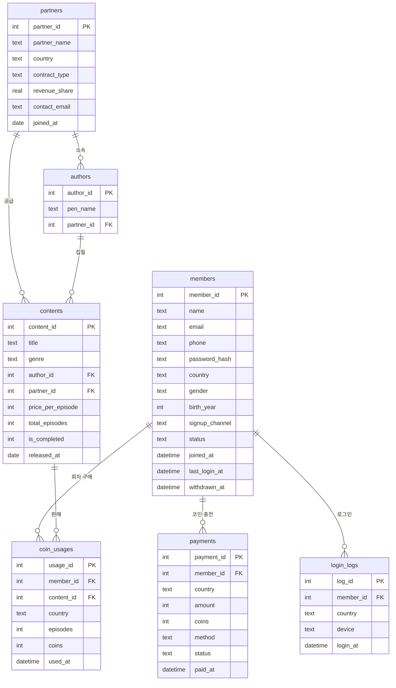

# 과제용 샘플 DB 설명

- 파일: `backend/data/content_platform.db` (SQLite, 서버 첫 실행 시 자동 생성 / git 에는 올리지 않음)
- 생성 코드: `backend/app/database/sample_db.py` (시드 `20222103` 고정 → 끝날짜가 같으면 항상 같은 데이터)
- 기간: 2025-01-01 ~ 생성일, 국가: KR / JP / TW
- 실제 회사 DB 를 쓰지 않고 과제용으로 새로 설계함. 워크시트에 적은 액터(회원·파트너사·작가)와
  질문 예시("국가별 매출", "이탈 회원", "매출 하위 업체")가 그대로 나오도록 테이블을 구성함.

## ERD

## 지표 정의 (템플릿 기준)

| 지표 | 정의 |
|---|---|
| 플랫폼 매출 | `payments` 에서 `status = 'paid'` 인 `amount` 합계 (환불 제외) |
| 작품·업체·장르 매출 | `coin_usages.coins` 합계 × 100원 (코인 1개 = 100원) |
| 신규 가입자 | `members.joined_at` 이 기간 안인 회원 수 |
| 탈퇴 회원 | `members.withdrawn_at` 이 기간 안인 회원 수 |
| DAU / MAU | `login_logs` 의 일별 / 월별 `COUNT(DISTINCT member_id)` |

플랫폼 매출(충전 결제)과 작품 매출(코인 사용)은 기준이 달라서 값이 다를 수 있음.
충전한 코인을 바로 다 쓰지 않기 때문.

## 개인정보·민감 컬럼 처리

| 컬럼 | 처리 |
|---|---|
| `members.password_hash` | SQL 검증기가 조회 자체를 차단 (COUNT 안에 있어도 차단) |
| `members.name` | 결과에서 가운데 글자 마스킹 (강민준 → 강\*준) |
| `members.email`, `partners.contact_email` | 결과에서 마스킹 (user0001@example.com → u\*\*\*@example.com) |
| `members.phone` | 결과에서 가운데 자리 마스킹 (010-1234-5678 → 010-\*\*\*\*-5678) |
| `members` 전체 | `SELECT *` 금지 — 필요한 컬럼만 지정해야 함 |

## 데이터 특징 (시연 시 참고)

- 매출은 완만하게 늘어나는 추세 + 주말에 조금 더 높음
- 업체마다 규모 차이를 둬서 "매출 하위 업체" 질문 결과가 의미 있게 나옴
- 작품 매출은 소수 인기작에 몰리도록 생성함 (지프 분포)
- 회원의 약 절반은 가입 후 일정 기간 뒤 로그인을 멈추고(이탈), 약 7%는 탈퇴함
